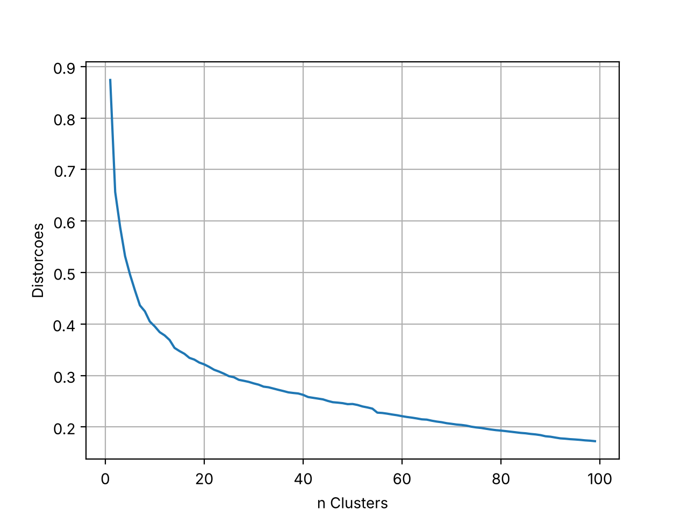

# Clusterização KMeans — Boston Housing

Avaliação do 2º bimestre: clusterizador KMeans treinado na base Boston Housing (`HousingData.csv`, 506 registros, 14 atributos).

## Arquivos

| Arquivo | Conteúdo |
|---|---|
| `boston_cluster.py` | Módulo de treinamento |
| `inferencia.py` | Módulo de inferência |
| `HousingData.csv` | Base fornecida na aula |
| `normalizador_boston.model` | MinMaxScaler treinado (dados numéricos) |
| `colunas_categoricas_boston.model` | Colunas geradas pelo `get_dummies` (`CHAS_0`, `CHAS_1`) |
| `boston_cluster.model` | Modelo KMeans treinado |
| `cotovelo.png` | Gráfico das distorções |

## Como executar

```bash
pip install -r requirements.txt
python boston_cluster.py   # treina e salva os modelos
python inferencia.py       # classifica a nova residência definida no início do arquivo
```

## Módulo de treinamento (`boston_cluster.py`)

1. **Valores ausentes:** a base tem NA em CRIM, ZN, INDUS, CHAS, AGE e LSTAT. Os numéricos recebem a mediana e o categórico recebe a moda.
2. **Normalização:** as colunas são separadas em categóricas e numéricas.
   - Numéricas: `MinMaxScaler` (salvo em `normalizador_boston.model`).
   - Categórica: `CHAS` (dummy do rio Charles), com `pd.get_dummies`.
3. **Balanceamento:** não aplicado, porque a clusterização não tem classe.
4. **Número ótimo de clusters:** calcula a distorção (média das distâncias euclidianas de cada registro ao centroide mais próximo, com `cdist`) para K = 1 a 99. Depois aplica o método do cotovelo: escolhe o ponto da curva com maior distância à reta entre o primeiro e o último ponto. Resultado: **14 clusters**.
5. **Treinamento definitivo** com o número ótimo e salvamento do modelo com `pickle`.



## Módulo de inferência (`inferencia.py`)

1. Recebe os dados da nova residência.
2. Normaliza com o normalizador salvo (`transform`) e com o `get_dummies`, completando as colunas do treinamento.
3. Infere o cluster com `predict`.
4. Desnormaliza o centroide do cluster inferido:
   - Numéricos: `inverse_transform`.
   - Categórico: `pd.from_dummies`, usando a categoria de maior proporção no cluster.

Exemplo de saída:

```
A nova residência pertence ao cluster: 8
Centroide do cluster 8 (dados desnormalizados):
                  0
CRIM       0.132124
ZN        11.460784
INDUS      7.261961
CHAS              0
NOX        0.445624
RM          6.31902
AGE       24.488235
DIS        5.830075
RAD         4.72549
TAX      298.764706
PTRATIO    17.74902
B         388.33098
LSTAT      8.347255
MEDV       24.45098
```

## Fontes

- Descrição dos atributos (U. Toronto / Delve): https://www.cs.toronto.edu/~delve/data/boston/bostonDetail.html
- Harrison, D.; Rubinfeld, D. L. *Hedonic housing prices and the demand for clean air*. J. Environ. Economics & Management, 5(1), 81–102, 1978.
- scikit-learn — KMeans: https://scikit-learn.org/stable/modules/generated/sklearn.cluster.KMeans.html
